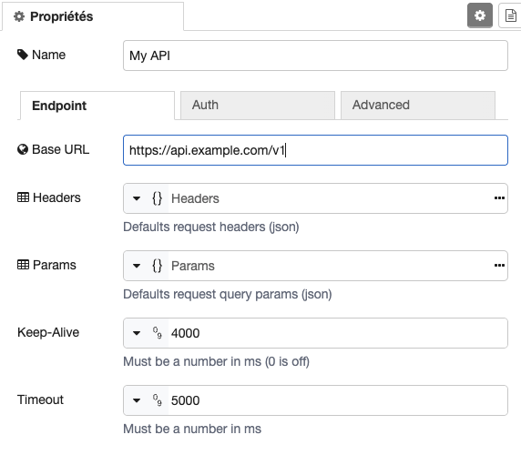
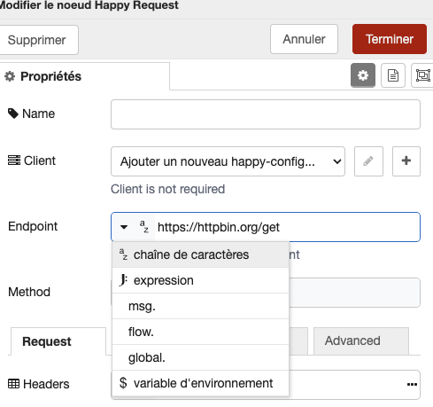
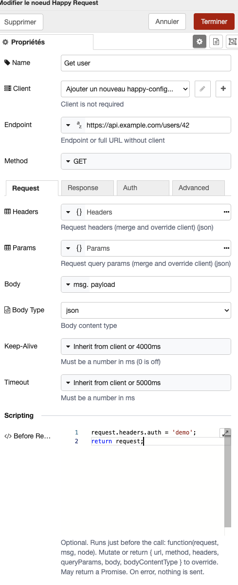
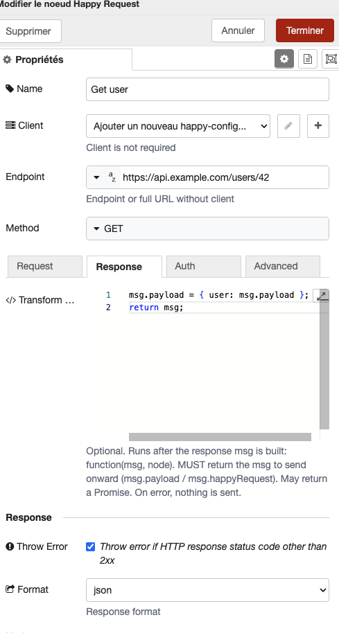
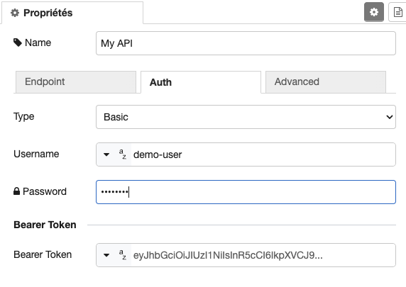
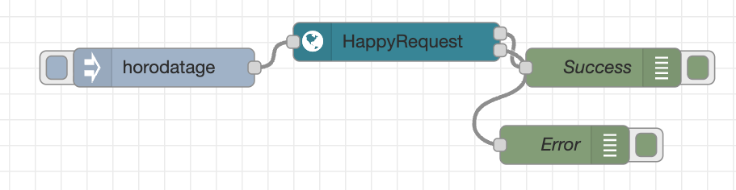

# node-red-contrib-happy-http-client

A highly flexible and customizable Node-RED node designed to simplify your HTTP requests.
Create and manage clients, parameterize everything, and handle errors effortlessly. 🛠️

<br/>
<p align="center">
  <a href="https://www.npmjs.com/package/@keload/node-red-dxp" aria-label="Build with node-red-dxp">
    
  </a>
</p>
<p align="center">
    <a href="https://github.com/clement-berard/node-red-contrib-happy-http-client/graphs/contributors">
        
    </a>
    <a href="https://github.com/clement-berard/node-red-contrib-happy-http-client/network/members">
        
    </a>
    <a href="https://github.com/clement-berard/node-red-contrib-happy-http-client/stargazers">
        
    </a>
    <a href="https://github.com/clement-berard/node-red-contrib-happy-http-client/issues">
        
    </a>
</p>
<p align="center">
  <a aria-label="NPM Version" href="https://www.npmjs.com/package/@keload/node-red-contrib-happy-http-client">
    
  </a>
  <a aria-label="NPM Download Count" href="https://www.npmjs.com/package/@keload/node-red-contrib-happy-http-client">
    
  </a>
</p>

## 📦 Installation

```bash
npm install @keload/node-red-contrib-happy-http-client
```

Or from the Node-RED editor: **Menu → Manage palette → Install**, then search for `@keload/node-red-contrib-happy-http-client`.

## ⚡ Quick Start

1. Drop a **Happy Config** node on the canvas (optional) and set a `Base URL`, e.g. `https://api.example.com/v1`.
2. Drop a **Happy Request** node, pick that config as its `Client`, and set `Endpoint` to `/users/42`.
3. Deploy and send it a message — the node makes the request and returns:

```js
msg.payload                        // response body
msg.happyRequest.ok                // true for 2xx responses
msg.happyRequest.response.status   // HTTP status code
```

No config node required — set a full URL directly as the `Endpoint` for one-off requests.

## Features

### Flexible Client Management

Create reusable HTTP clients (`Happy Config` nodes) to store a base URL, default headers, auth, and timeouts once, then reuse them across as many `Happy Request` nodes as needed — or skip the client entirely for ad-hoc calls.



### Full Parameterization

URL, headers, query params, and body all accept a static value, a `msg`/`flow`/`global` property, an environment variable, or a JSONata expression.



### 🧩 Scripting: Before Request & Transform Response

Add optional JavaScript directly in the node, with a full code editor (syntax highlighting, expandable to full screen) — the same editor Node-RED's core Function node uses.

- **Before Request** (Request tab): runs just before the call is made. Receives `(request, msg, node)` and can mutate or return `{ url, method, headers, queryParams, body, bodyContentType }` to override the resolved request.
- **Transform Response** (Response tab): runs after the response is built. Receives `(msg, node)` and must return the `msg` to send onward — reshape the payload, add fields, whatever you need.

Both are optional — leave them empty and the node behaves exactly as before. Either one can return a `Promise`. If a script throws, the node reports an error and nothing is sent, so failures never pass silently.

<p align="center">
  
  
</p>

### Authentication

Basic, Bearer, or Digest — configure once on the client and inherit it everywhere, or override it per request.



### Advanced Error Handling & Dual Outputs

Choose whether the node throws on non-2xx responses, and optionally split successes and errors into two separate outputs for explicit branching in your flow.



### TLS

Toggle certificate verification (`rejectUnauthorized`) per client or per request.

### Built with `urllib`

Powered by [urllib](https://www.npmjs.com/package/urllib) for reliable, high-performance HTTP under the hood.

## Contributing & Developer Experience

This package is built with [node-red-dxp](https://www.npmjs.com/package/@keload/node-red-dxp) and written in TypeScript, keeping the codebase structured and easy to extend.

Issues, pull requests, and ideas are welcome — see [CHANGELOG.md](CHANGELOG.md) for recent changes.

## License

MIT
